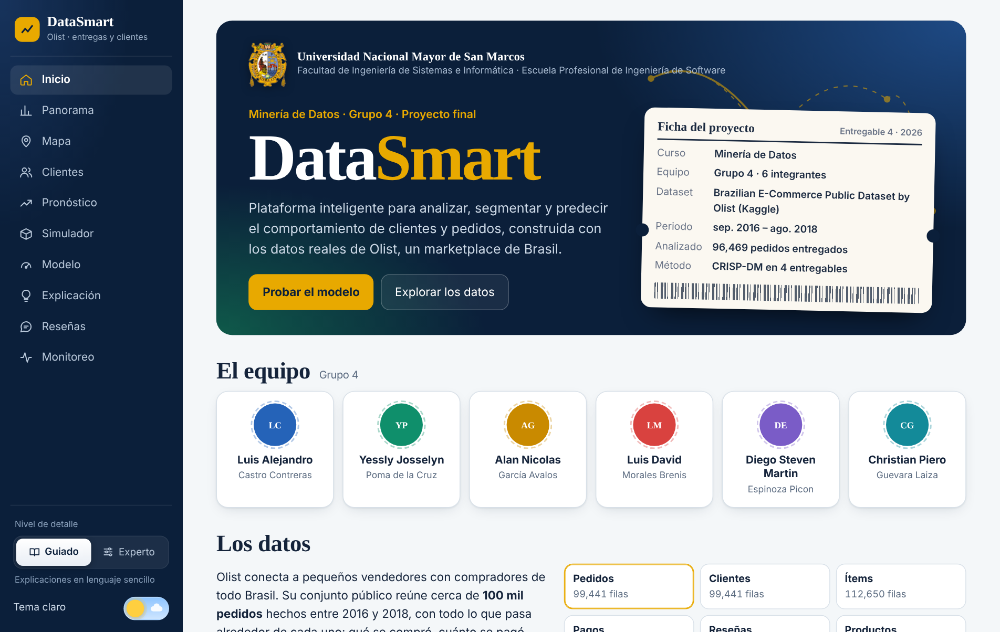
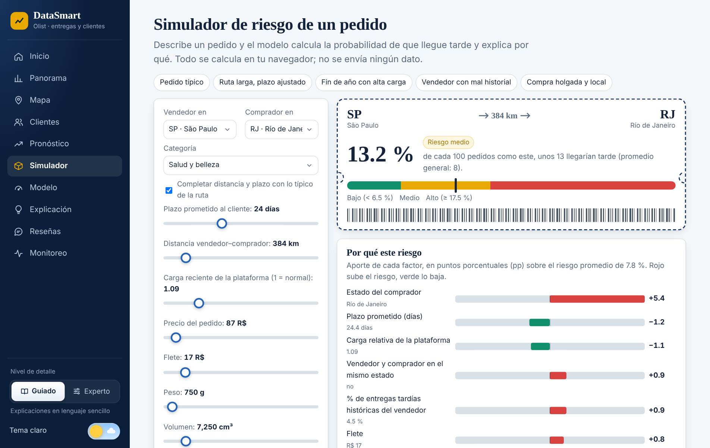
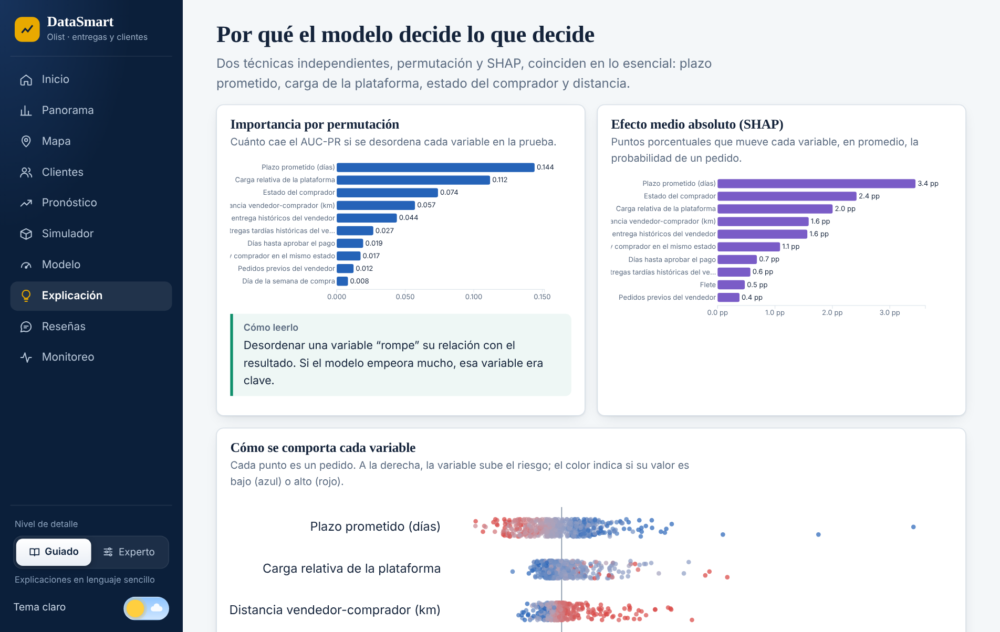
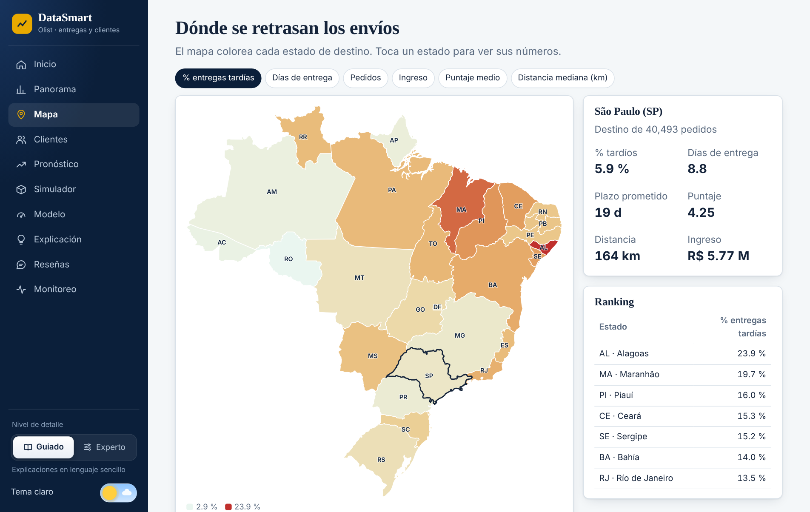
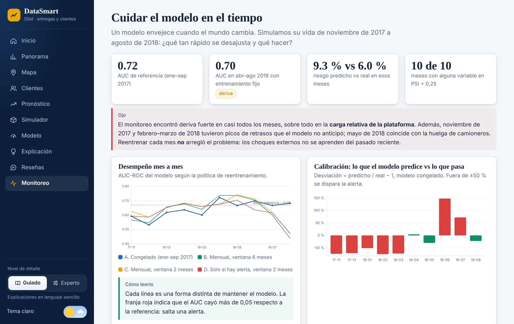
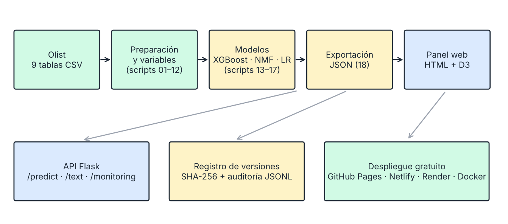

<div align="center">

# DataSmart · Olist

**¿Llegará a tiempo este pedido?** Plataforma de minería de datos que analiza, segmenta y predice el comportamiento de clientes y entregas con ~100 mil pedidos reales de un marketplace brasileño, y explica cada predicción.

[](https://github.com/RedSteinYT/datasmart-olist/actions/workflows/ci.yml)


**[Ver el panel en vivo](https://datasmart-olist-grupo4.netlify.app)** · **[API en vivo](https://datasmart-olist.onrender.com/api/health)** · **[Informe final (PDF)](docs/Informe_Final_DataSmart_Grupo4.pdf)** · **[Presentación](docs/Presentacion_DataSmart_Grupo4.pptx)**

<sub>Proyecto final del curso de Minería de Datos · Universidad Nacional Mayor de San Marcos · FISI · Escuela de Ingeniería de Software · Grupo 4 · 2026</sub>

</div>



> **In English:** end-to-end data mining project on the Olist Brazilian e-commerce dataset. An XGBoost classifier estimates, at purchase time, the risk that an order will arrive late (ROC-AUC 0.78 random split, 0.70 temporal), explains each prediction with SHAP, mines Portuguese reviews, and simulates production monitoring with drift detection and model versioning. The interactive dashboard runs the model **in the browser** (trees exported to JSON, verified against Python to 3×10⁻⁷).

## Lo que hace

| | |
|---|---|
| **Simulador de riesgo** | Describes un pedido (ruta, plazo, producto) y el modelo calcula la probabilidad de entrega tardía y qué factores la suben o la bajan, todo en el navegador. |
| **Explicabilidad** | Importancia por permutación, SHAP exacto (aditivo) y LIME, con casos explicados uno a uno. |
| **Minería de textos** | Sentimiento, aspectos y temas de 39 661 reseñas en portugués (TF-IDF + regresión logística, NMF). |
| **Monitoreo** | Simulación mes a mes con deriva (PSI), alertas, 4 políticas de reentrenamiento, versionado con hash SHA-256 y auditoría. |
| **Análisis de negocio** | Reglas de asociación (Apriori, FP-Growth, ECLAT), segmentos RFM + K-Means, grafo de categorías, pronóstico de ventas y mapa de Brasil. |

<table><tr>
<td width="50%"></td>
<td width="50%"></td>
</tr><tr>
<td></td>
<td></td>
</tr></table>

## Resultados

| Tarea | Mejor modelo | Resultado |
|---|---|---|
| Entrega tardía (clasificación) | XGBoost | AUC-ROC **0,783** (IC 95 % 0,769–0,794) · AUC-PR **0,317** (azar 0,081) · validación temporal 0,704 |
| Días de entrega (regresión) | XGBoost v3 | R² **0,405** · MAE **4,44 días** (de 0,29 en v1 al sumar distancia, plazo, carga y vendedor) |
| Sentimiento de reseñas | Regresión logística + TF-IDF | AUC **0,973** |
| Ventas diarias | Ridge con rezagos | MAPE **11,8 %** (SARIMA 31,5 %, Prophet 24,6 %) |
| Segmentación | K-Means (k = 4) | Segmento de insatisfechos: 15,5 % de clientes, reseña 1,66 |

Resultados negativos que también se reportan: SMOTE y ADASYN empeoraron el AUC-PR (0,22 frente a 0,30), PCA/LDA/QDA no mejoraron al modelo completo y reentrenar cada mes no superó al modelo congelado.

## Arquitectura



- **Análisis** (`analysis/`): 21 scripts de Python reproducibles (pandas, scikit-learn, XGBoost, SHAP, LIME, NetworkX), semilla 42.
- **Panel** (`web/`): HTML + D3.js sin compilación. El modelo XGBoost se exporta a JSON y se evalúa en JavaScript con redondeo a 32 bits (`Math.fround`) para coincidir con Python.
- **API** (`app/`): Flask, desplegada en Render. Sirve predicciones con aportes SHAP exactos (`pred_contribs`).
- **Calidad**: 23 pruebas con pytest, pruebas de paridad Python–JavaScript y prueba de humo en navegador (escritorio y móvil).

## API

Base: `https://datasmart-olist.onrender.com` (plan gratuito: la primera petición tras 15 min sin uso tarda ~1 min en despertar).

| Método | Ruta | Descripción |
|---|---|---|
| GET | `/api/health` | Estado del servicio |
| POST | `/api/predict` | Probabilidad de retraso, banda y aporte de cada factor |
| POST | `/api/text` | Sentimiento y aspectos de un comentario |
| GET | `/api/monitoring` | Resumen de la simulación de monitoreo |
| GET | `/api/model/versions` | Registro de versiones con hash |
| GET | `/api/audit?n=20` | Registro de auditoría |

```bash
curl -X POST https://datasmart-olist.onrender.com/api/predict \
  -H "Content-Type: application/json" \
  -d '{"customer_state":"RJ","seller_state":"SP","categoria_principal":"health_beauty","dias_estimados":24,"precio_total":87,"flete_total":17,"distancia_km":384}'

curl -X POST https://datasmart-olist.onrender.com/api/text \
  -H "Content-Type: application/json" -d '{"texto":"não recebi o produto, péssimo"}'
```

## Ejecutar en local

```bash
git clone https://github.com/RedSteinYT/datasmart-olist.git && cd datasmart-olist
pip install -r requirements-api.txt
python app/api.py                 # API + panel en http://localhost:8000
python -m pytest -q tests         # pruebas
python tools/construir_sitio.py   # genera dist/ y dist/datasmart.html (un solo archivo)
```

Para **reproducir todo el análisis** descarga el [dataset de Kaggle](https://www.kaggle.com/datasets/olistbr/brazilian-ecommerce), copia los CSV a `data/raw/olist/`, instala `requirements.txt` y ejecuta los scripts de `analysis/` en el orden del Anexo A del [informe](docs/Informe_Final_DataSmart_Grupo4.pdf). Los datos no se incluyen en el repositorio.

## Estructura

```
analysis/   scripts 00–21 y sus resultados (CSV, JSON, figuras)
app/        API Flask
src/        lógica compartida: variables y servicio de predicción
models/     modelo XGBoost (JSON), metadatos y registro de versiones
web/        panel (HTML, CSS, JS, D3) y pruebas de paridad
tests/      pruebas con pytest
docs/       informe final, presentación, guion y guía de despliegue
tools/      construcción del sitio estático
```

## Equipo · Grupo 4

Luis Alejandro Castro Contreras · Yessly Josselyn Poma de la Cruz · Alan Nicolas García Avalos · Luis David Morales Brenis · Diego Steven Martin Espinoza Picon · Christian Piero Guevara Laiza

## Licencias

Código bajo licencia [MIT](LICENSE). Datos: *Brazilian E-Commerce Public Dataset by Olist* (Kaggle, CC BY-NC-SA 4.0), no incluidos. Mapa: [@svg-maps/brazil](https://github.com/VictorCazanave/svg-maps) (CC BY 4.0). Gráficos: D3 (ISC).
